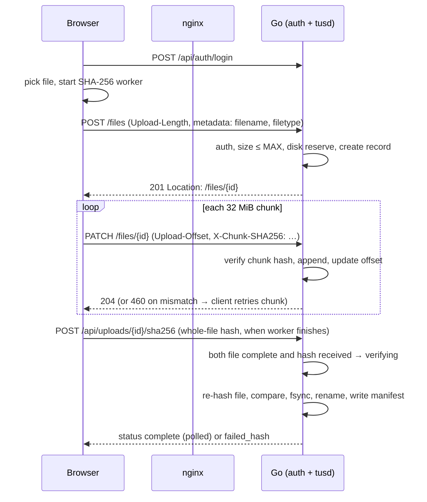

# Large File Uploader: Go + React Design (tus)

Status: draft · Date: 2026-11-01

## 1. Summary

We are replacing the PHP and half-finished Go prototypes with a single Go backend and a React SPA that upload files of up to **100 GiB** (typically ~50 GB) over a browser, behind a login, with end-to-end SHA-256 verification. Resumable transfer is delegated to the [tus](https://tus.io) protocol via `tusd` embedded in the Go server, instead of the hand-rolled chunk protocol that failed the audit.

Goals:

- Users upload large files from a browser with no SFTP knowledge.
- Uploads survive network drops, tab reloads and server restarts (resume).
- A file is only marked complete after the server proves its SHA-256 matches what the browser computed from the original file.
- Login required; root admin creates the handful of users.
- Same deployment style as bruttice: `docker compose up`, nginx as the only public entry point.

Non-goals (v1):

- Object storage (S3/MinIO). Files live on a local volume.
- Public sign-up, SSO, email, password-reset-by-email.
- A browser download or file-browsing UI. Admins collect files from the host volume.
- Multi-node or horizontally scaled backend.
- Parallel multi-connection upload of a single file (see §5.4).

## 2. Requirements and constraints

| Requirement | Decision |
|---|---|
| Storage | Local docker volume / bind mount, one filesystem for `incoming/` and `complete/` so finalize is an atomic `rename` |
| Users | Handful (<20). Root admin from env at first boot; root creates users in an admin page |
| Typical file | ~50 GB |
| Hard limit | **Files must be smaller than 100 GiB** (`MAX_UPLOAD_BYTES=107374182400`; an `Upload-Length` greater than or equal to it is rejected), enforced server-side and mirrored client-side |
| Integrity | Whole-file SHA-256 verified server-side; per-chunk SHA-256 on every PATCH |
| Login | Username + password (argon2id), cookie session |
| Stack | Go backend; React 19 + TypeScript + Vite + Tailwind 4 + zustand + react-router 7 + vitest + eslint + pnpm on Node 22 (mirrors `~/bruttice/bruttice/apps/frontend`) |

Sizing consequences of a 100 GiB limit:

- At 100 Mbit/s a 50 GB upload takes about 1.1 hours; at 1 Gbit/s about 7 minutes. Sessions and timeouts must tolerate hour-long uploads (§4.3).
- Browser SHA-256 over 50 GB in WASM takes a few minutes of CPU (roughly 300–500 MB/s). It runs in a Web Worker alongside the upload.
- Server re-hash of a 100 GiB file is bounded by disk read speed: ~4 min at 500 MB/s, ~11+ min on a spinning disk. Finalization is therefore asynchronous with a visible "verifying" state.
- Free disk space must be checked up front (§7.3).

## 3. Architecture

```
 browser (React SPA)
   │  HTTPS
   ▼
 host nginx (bare metal, certbot TLS)  ──►  127.0.0.1:${PORT}
   │
 ┌──────────────────────── docker network: lfu ───────────────────────┐
 │ nginx (routing proxy, published on 127.0.0.1:${PORT} only)          │
 │   /          → frontend:8080                                        │
 │   /api/*     → backend:8080                                         │
 │   /files/*   → backend:8080  (tus, no request buffering)            │
 │                                                                     │
 │ frontend (nginx-unprivileged serving the built SPA, :8080 internal) │
 │                                                                     │
 │ backend (Go, non-root, distroless)                                  │
 │   auth middleware → { /api/* handlers , tusd handler at /files/ }   │
 │   SQLite (users, sessions, uploads)       volume: lfu-db            │
 │   tusd filestore + finalizer              volume: uploads           │
 └─────────────────────────────────────────────────────────────────────┘
```

Compose services:

| Service | Image | Publishes | Notes |
|---|---|---|---|
| `nginx` | stock `nginx` image + mounted `nginx.conf` | `127.0.0.1:${PORT}:80` | Internal routing proxy and the only published port, bound to loopback. The bare-metal host nginx terminates TLS and forwards to it (§10.4) |
| `frontend` | multi-stage: `node:22-alpine` + pnpm builds the SPA, then `nginxinc/nginx-unprivileged` serves `dist/` | none | Production static server, non-root, SPA fallback to `index.html`, long-cache hashed assets, no-cache `index.html`. No dev server, no `vite preview` |
| `backend` | multi-stage Go build → distroless/static, non-root | none | Mounts `uploads` and `db` volumes |

Same service split as bruttice (`nginx`, `frontend`, `backend`), but the `frontend` image is a true production image. Bruttice's prod stage runs `vite preview`, which is not a production server; that is a separate fix for that repo. Ours has a build stage (install with `--frozen-lockfile`, `pnpm test` as a build target for CI, `pnpm build`) and a runtime stage containing only nginx and the compiled `dist/`. No Postgres: SQLite (pure-Go `modernc.org/sqlite`, no CGO) is enough for <20 users and keeps the distroless image simple.

Repository layout after the rewrite:

```
backend/            go.mod, cmd/server, internal/{config,auth,users,uploads,store,httpx}
frontend/           Vite app (package.json, src/, vitest), Dockerfile, nginx.conf (static server config)
nginx/              nginx.conf (public reverse proxy)
docs/               this document
docker-compose.yaml
.env.example        (the committed .env is removed)
```

`php/` and `go/` are deleted.

## 4. Authentication and user management

### 4.1 Accounts

- Roles: `admin` and `user`. Exactly one `root` account (an `admin` flagged `is_root`) exists. It cannot be deleted or disabled.
- On first start, if the `users` table is empty, the backend creates root from `ROOT_USERNAME` and `ROOT_PASSWORD`, stores only the argon2id hash, and logs a notice that the env password should be removed. Root is flagged `must_change_password`.
- The admin page (admin only) can: list users, create a user with a temporary password, disable or enable, delete, and reset a password. Reset and create set `must_change_password`; the user is forced to a change-password screen before anything else.
- Self-service: change own password.

### 4.2 Passwords and sessions

- Passwords: argon2id (`golang.org/x/crypto/argon2`), 64 MiB, t=3, p=2, 16-byte random salt, parameters stored with the hash so they can be raised later. Minimum 12 characters.
- Sessions: 32-byte random token from `crypto/rand`. The DB stores only `SHA-256(token)`. The cookie is `HttpOnly; Secure; SameSite=Strict; Path=/`.
- CSRF: SameSite=Strict plus an `Origin`/`Host` check on all state-changing requests; tus requests must also carry `Tus-Resumable`, which a cross-site form cannot set.
- Constant-time comparison everywhere a secret is compared.

### 4.3 Session lifetime

A 50 GB upload can run for over an hour, so the session is **sliding**: 24 h idle timeout, refreshed by any authenticated request including tus PATCHes (throttled to one DB write per minute). Absolute maximum 14 days. Sessions are revoked on logout, password change and user disable.

### 4.4 Brute-force protection

In-memory limiter keyed by (client IP, username): 5 failures then exponential backoff capped at 15 min, plus a global per-IP ceiling. Client IP is taken from `X-Forwarded-For` only when the peer is the nginx container. Failed and successful logins are logged (no passwords).

## 5. Upload protocol

### 5.1 Why tus

tus gives resumable, offset-based uploads (`POST` create → `HEAD` offset → `PATCH` bytes) with retry semantics defined by a spec, and `tusd` is the reference Go implementation we embed as a library (`github.com/tus/tusd/v2/pkg/handler` + `filestore`). It replaces the prototype's chunk queue, JSON/base64 transport, and missing resume.

### 5.2 Request flow



### 5.3 Chunking

- Client chunk size: **32 MiB** (`tus-js-client` `chunkSize`). 100 GiB is about 3,200 PATCH requests. A failed chunk costs at most 32 MiB of resend.
- nginx `client_max_body_size 64m` on `/files/` bounds per-request memory and abuse; it is *not* the file-size limit.
- `tus-js-client` retries with backoff (`retryDelays: [0, 1s, 3s, 10s, 30s, 60s]`), and resumes from the server's `Upload-Offset` after any failure.

### 5.4 Parallelism

v1 is **sequential, single connection**. tus parallel upload uses the concatenation extension, which creates partial uploads and then joins them; with the filestore this means copying data again and temporarily needing ~2× disk for a 100 GiB file. We reject that cost for v1. If a single connection cannot saturate a user's link, revisit with an upload-id-per-region design.

### 5.5 Server-side limits

- `handler.Config.MaxSize = MAX_UPLOAD_BYTES`, plus a `PreUploadCreateCallback` that also rejects `Upload-Length` ≤ 0 or deferred length (we require known size).
- Metadata `filename` is stored but **never used as a path** (§8).
- `memorylocker` prevents two concurrent PATCHes on the same upload (single backend instance).
- Uploads are bound to the creating user: the pre-create callback records `user_id`; HEAD/PATCH/DELETE on an id verify ownership (admins can view and delete any).

## 6. Integrity and hashing

Three layers, from cheapest to strongest:

1. **Per-chunk (transit/read errors).** Before each PATCH the browser computes SHA-256 of the 32 MiB slice with `crypto.subtle.digest` and sends it in an `X-Chunk-SHA256` header through a small `tus-js-client` HTTP-stack wrapper (`frontend/src/lib/chunkHttpStack.ts`). The wrapper refuses to send a PATCH body it cannot hash. The backend middleware (`backend/internal/uploads/files.go`) buffers the chunk (bounded by `CHUNK_SIZE_MIB + 4 MiB`), verifies the hash, and only then hands the bytes to tusd. A mismatch returns `460` and tusd never sees the data, so the offset is unchanged and the client resends that chunk. **Spike result:** tusd v2.10.1 has *no* checksum extension (the `Upload-Checksum` header and `Tus-Checksum-Algorithm` do not exist in it), so this check lives in our own middleware instead. A PATCH without the header is rejected with 400.
2. **Completeness.** tusd only reports the upload finished when offset equals declared length. The finalizer additionally requires `stat.Size == declared length` before hashing.
3. **Whole file (end-to-end).** A Web Worker streams the file through an incremental SHA-256 (`hash-wasm`; Web Crypto cannot hash incrementally) reading 8 MiB slices, running concurrently with the upload. When done it posts the hex digest to `POST /api/uploads/{id}/sha256`. The server, once it has both a complete file and a digest, re-hashes the file on disk and compares. On match the upload becomes `complete`; on mismatch it is moved to `quarantine/` and marked `failed_hash`.

Edge cases:

- If the browser finishes hashing before or after the upload ends, either order works; the server waits for both.
- The worker compares `file.size` and `file.lastModified` at start and end. If the file changed mid-upload, the client aborts and reports it.
- The digest is immutable once accepted (409 on a second, different value).
- Server re-hash runs in a bounded worker pool (default 1 concurrent) to avoid saturating disk I/O; status shows `verifying` with bytes hashed.
- Final `manifest.json` records SHA-256, size, user, original filename, tus id and timestamps.

## 7. Storage layout and lifecycle

### 7.1 Directories (one volume, one filesystem)

```
/data/uploads/
  incoming/<tus-id>            tusd data file
  incoming/<tus-id>.info       tusd metadata
  complete/<yyyy>/<upload-uuid>/<safe-filename>
  complete/<yyyy>/<upload-uuid>/manifest.json
  quarantine/<upload-uuid>/…   failed hash, kept until an admin deletes it
/data/db/lfu.sqlite            (separate volume)
```

Access from the host: files are collected directly from the volume, so `uploads` is a **bind mount** (e.g. `/srv/lfu/uploads`), not an opaque named volume. The backend runs as a fixed UID/GID (`LFU_UID`/`LFU_GID`, default 10001) and creates `complete/` entries with mode `0640` (directories `0750`) so a host group can read them. Admins should treat `complete/` as read-only.

### 7.2 States

`created → uploading → received → verifying → complete`, with side exits `failed_hash`, `aborted`, `expired`.

### 7.3 Disk safety

- At create: require `free_bytes ≥ declared_length + RESERVE_BYTES` (default 10 GiB) minus the sum of remaining bytes of other in-flight uploads (tracked in the DB). Otherwise `507`-style rejection with a clear UI message.
- Finalize is `fsync` then `rename` within the same filesystem, so a crash never leaves a half-written file in `complete/`.
- On startup the backend reconciles DB rows against files on disk and re-queues any upload in `received` or `verifying`.

### 7.4 Janitor

A goroutine runs hourly: terminate *incomplete* uploads with no activity for `PARTIAL_EXPIRY_DAYS` (default 7, state `expired`) and remove orphan `incoming/` files with no DB row. **Completed files are never auto-deleted**, and neither are quarantined files; an admin removes quarantine entries from the admin uploads page.

## 8. Security hardening

Each audit finding maps to a concrete control:

| Audit finding | Control |
|---|---|
| No auth (PHP), `phpinfo()` exposed | Every `/api` and `/files` route behind auth middleware except `/api/auth/login` and `/api/healthz`; no debug endpoints |
| Path traversal via filename and version | Client names are never used in paths. Files are stored by server-generated UUID. Display/final names pass through `filepath.Base`, a character allowlist, a length cap, and reserved-name checks; collisions impossible because the directory is the UUID |
| Checksum disabled / weak CRC "version" | Real SHA-256 per chunk and whole file; no client-derived identifiers |
| Concurrent map panic, tokens never expire | No in-memory token map. Sessions in SQLite; upload ownership by `user_id` |
| Shared plaintext creds in committed `.env` | Per-user argon2id hashes; `.env.example` only; root password from env used once |
| `io.ReadAll` of whole body, no body limits | tusd streams to disk; `http.MaxBytesReader` on all JSON endpoints; nginx 64 MB cap on `/files/` |
| No server timeouts | `ReadHeaderTimeout 10s`, `ReadTimeout`/`WriteTimeout` 10 min (bounded by chunk size), `IdleTimeout 2m` |
| Root container, full toolchain | distroless static image, non-root UID, read-only root FS, writable volumes only |
| Host networking, no isolation | Private compose network; only nginx publishes a port |
| Static handler serving source files | SPA served by a dedicated production nginx container from the compiled `dist/` only; no source, no dev server |
| Silent failures, assembly in goroutine | Explicit state machine; errors persisted to the `uploads` row and shown in UI |
| No rate limiting on login | §4.4 |

Additional:

- Security headers from nginx: `Content-Security-Policy` (self only), `X-Content-Type-Options`, `Referrer-Policy: no-referrer`, HSTS when TLS is on.
- Structured logs (`log/slog`); never log request bodies, cookies or passwords.
- Dependency pinning: `go.sum`, `pnpm-lock.yaml` frozen in CI; `govulncheck` and `pnpm audit` in CI.

## 9. Frontend

### 9.1 Pages

| Route | Who | Purpose |
|---|---|---|
| `/login` | public | Username and password |
| `/change-password` | any | Forced after create/reset, also voluntary |
| `/` (Upload) | user | File picker/drop zone, active upload card |
| `/uploads` | user | Own upload history with status, size, hash |
| `/admin/users` | admin | Create, disable, reset, delete users |
| `/admin/uploads` | admin | All uploads, abort, view quarantine |

### 9.2 Upload card behaviour

- Shows file name, size, upload progress and speed/ETA, hashing progress, and the final status (`uploading`, `verifying`, `complete`, `failed_hash`).
- Controls: pause, resume, cancel (cancel issues tus `DELETE`).
- Uploads are queued one at a time per browser.
- After a reload the user must **re-select the same file** to resume; browsers do not let a page re-open a local file silently. `tus-js-client`'s stored upload URL is matched by (name, size, lastModified) and the upload continues from the server offset. The UI says so explicitly when it detects a resumable upload.
- Warnings before start: size over `MAX_UPLOAD_BYTES` rejected client-side with the same message the server uses.

### 9.3 Technical choices

- `tus-js-client` directly rather than Uppy: we need a custom checksum HTTP stack and a Tailwind UI that matches bruttice, and Uppy's dashboard would be mostly unused.
- zustand stores: `auth` (current user), `uploads` (queue, progress). react-router 7 with a route guard on role.
- Hash worker: `frontend/src/workers/sha256.worker.ts`, message protocol `start/progress/done/error`. Pure and unit-testable with known vectors.
- Keep bruttice's `services/api.ts` pattern for fetch wrappers: JSON, `credentials: 'same-origin'`, central 401 handling that redirects to `/login`.
- Tests: vitest for stores, hash worker (known SHA-256 vectors, incremental equals one-shot), API wrapper, route guards.

## 10. API surface and data model

### 10.1 HTTP API

| Method and path | Auth | Description |
|---|---|---|
| `POST /api/auth/login` | none | Sets session cookie; rate limited |
| `POST /api/auth/logout` | user | Revokes session |
| `GET /api/auth/me` | user | Current user, role, `must_change_password` |
| `POST /api/auth/password` | user | Change own password |
| `GET /api/admin/users` | admin | List users |
| `POST /api/admin/users` | admin | Create user (username, temp password, role) |
| `PATCH /api/admin/users/{id}` | admin | Enable/disable, reset password |
| `DELETE /api/admin/users/{id}` | admin | Delete (not root) |
| `GET /api/uploads` | user | Own uploads (admin: all via `?all=1`) |
| `GET /api/uploads/{id}` | owner/admin | Status, progress, verify progress, error |
| `POST /api/uploads/{id}/sha256` | owner | Submit whole-file digest |
| `DELETE /api/uploads/{id}` | owner/admin | Abort and delete partial data |
| `GET /api/healthz` | none | Liveness |
| `* /files/…` | user | tus endpoints (POST, HEAD, PATCH, DELETE, OPTIONS) |

### 10.2 SQLite schema (sketch)

```sql
users(id, username UNIQUE, password_hash, role, is_root, disabled,
      must_change_password, created_at, last_login_at)

sessions(token_hash PRIMARY KEY, user_id, created_at, last_seen_at,
         expires_at, ip, user_agent)

uploads(id UUID PRIMARY KEY, tus_id UNIQUE, user_id, original_name,
        size_bytes, bytes_received, client_sha256, server_sha256,
        state, error, final_path, created_at, updated_at, completed_at)
```

Migrations are embedded SQL applied at start (`goose` or a minimal numbered-file runner); WAL mode on.

### 10.3 Configuration (`.env.example`)

`PORT`, `HOST`, `ROOT_USERNAME`, `ROOT_PASSWORD`, `MAX_UPLOAD_BYTES=107374182400`, `CHUNK_SIZE_MIB=32` (advertised to the SPA), `RESERVE_BYTES`, `UPLOAD_DIR=/data/uploads`, `DB_PATH=/data/db/lfu.sqlite`, `SESSION_IDLE_HOURS=24`, `TRUSTED_PROXY_CIDR`.

### 10.4 nginx and TLS

TLS is handled by the bare-metal host nginx with certbot. The compose `nginx` only routes between containers and is bound to `127.0.0.1:${PORT}`, so it is never reachable except through the host nginx. Two proxies are in the path, so **both must disable request buffering** and allow the same timeouts and body sizes; otherwise a 32 MiB chunk is buffered to disk twice.

Compose `nginx` (container routing):

- `/files/`: `proxy_request_buffering off; proxy_buffering off; client_max_body_size 64m; proxy_read_timeout 600s; proxy_send_timeout 600s; proxy_http_version 1.1`.
- `/api/`: `client_max_body_size 1m`.
- `/`: proxy to `frontend:8080`.
- `real_ip_header X-Forwarded-For` with `set_real_ip_from` the host's loopback/docker gateway, so the backend sees the true client IP. The backend trusts `X-Forwarded-For` only from this container (`TRUSTED_PROXY_CIDR`).
- Passes through `X-Forwarded-Proto` from the host nginx; tusd uses `RespectForwardedHeaders` so `Location` URLs are `https://`.

Host nginx (certbot-managed server block), the parts that matter for uploads:

```nginx
server {
    listen 443 ssl;                       # certbot manages the ssl_* lines
    server_name upload.example.com;

    client_max_body_size 64m;             # per request (one chunk), not file size
    proxy_request_buffering off;
    proxy_buffering off;
    proxy_http_version 1.1;
    proxy_read_timeout 600s;
    proxy_send_timeout 600s;

    add_header Strict-Transport-Security "max-age=31536000" always;

    location / {
        proxy_pass http://127.0.0.1:8081;   # ${PORT}
        proxy_set_header Host $host;
        proxy_set_header X-Forwarded-For $remote_addr;
        proxy_set_header X-Forwarded-Proto $scheme;
    }
}
```

The session cookie is `Secure`, so the app only works over HTTPS; local development uses a flag (`DEV_INSECURE_COOKIES=1`, never in the compose file) to relax that. The example host config will live in `docs/host-nginx.conf` and be checked by `nginx -t` in the deploy notes.

## 11. Testing strategy

| Level | What |
|---|---|
| Go unit | Password hashing and params upgrade, session expiry and sliding refresh, limiter, filename sanitizer (table of traversal and Unicode cases), disk-reserve math |
| Go integration | `httptest` server with real tusd and temp dir: unauthenticated request rejected; create over limit rejected; upload with bad chunk hash gets 460 and retries; truncated upload resumes from offset; whole-file hash mismatch → quarantine; correct hash → atomic finalize and manifest; owner isolation between two users |
| Frontend | vitest: hash worker vectors, upload store transitions, 401 handling, route guards; eslint and `tsc -b` as in bruttice |
| E2E (compose) | Playwright against `docker compose up`: login, upload 2 GB, kill backend mid-upload, restart, resume, verify hash |
| Scale/soak (manual or nightly) | 20 GB sparse-generated file, then one ~100 GiB run recording browser memory, server I/O and finalize time; confirm a file of exactly 100 GiB is rejected and 100 GiB − 1 byte is accepted |
| Security | `govulncheck`, `pnpm audit`, a traversal fuzz over metadata fields, cookie flags check |

## 12. Implementation phases

1. **Clean slate and scaffolding.** Delete `php/`, `go/`, root `.env`; create `backend/`, `frontend/` (with production Dockerfile), `nginx/`, compose, `.env.example`, CI (go test, vet, govulncheck; pnpm test/lint/build). *Done when* `docker compose up` serves a placeholder SPA from the production `frontend` container and `/api/healthz`.
2. **Auth and users.** SQLite + migrations, argon2id, sessions, root bootstrap, limiter, login/change-password pages, admin users page. *Done when* the root can create a user who can log in and is forced to change the password.
3. **tusd behind auth.** Filestore, ownership, size/disk checks, per-chunk checksum spike (§6.1), janitor. *Done when* curl-driven tus upload works for a user and is rejected for others.
4. **Upload UI and hashing.** tus client with checksum stack, hash worker, upload card with pause/resume/cancel, history page. *Done when* a 5 GB file uploads and resumes after a tab reload.
5. **Finalizer.** Digest endpoint, verify pool, atomic finalize, quarantine, manifest, startup reconciliation. *Done when* corrupting a byte on disk produces `failed_hash`.
6. **Hardening and soak.** nginx headers and timeouts, distroless/non-root, readonly FS, TLS docs, 20 GB and ~100 GiB soak tests, README rewrite.

## 13. Risks

Risks:

- **Browser hash throughput.** SHA-256 over 50–100 GiB may take 3–6+ minutes of CPU in WASM and compete with upload read I/O. Mitigated by running concurrently in a worker; measure in phase 4. If too slow, hash per-chunk only and hash whole file server-side with the client digest as a Merkle-of-chunks list instead.
- **Verification time at 100 GiB** on slow disks (10+ minutes). UI shows progress; completion is not instantaneous.
- **Chunk checksum is our own protocol extension**, not part of tus: standard tus clients that do not send `X-Chunk-SHA256` are refused. That is intentional (integrity is mandatory) but means the bundled web client is the supported client.
- **Resume requires re-selecting the file** after reload; a browser limitation (File System Access handles are Chromium-only and not relied on).
- **Mid-upload file modification** is detected only by size/mtime comparison.

## 14. Decisions on earlier open questions

| Question | Decision |
|---|---|
| File size limit | Files must be smaller than 100 GiB (107,374,182,400 bytes) |
| How admins collect files | Directly from the host volume (bind mount, group-readable); no in-app download |
| TLS | Host nginx on bare metal with certbot; compose nginx is loopback-only behind it |
| Quotas | None per user; the global disk reserve (§7.3) is the only guard |
| Retention | No auto-delete of completed files. Only abandoned partial uploads expire, and quarantine is cleared by an admin |

## 15. Implementation status and verification

Implemented on branch `rebuild-in-go`: all of phases 1 to 5, plus the container, compose, nginx, CI and host-nginx pieces of phase 6.

What was actually run (not just written):

| Check | Result |
|---|---|
| Go unit and integration tests (`go test -race ./...`): auth, limiter, name sanitizer, forced password change, cookie flags, cross-origin refusal, size limit boundary (exactly the limit rejected, limit − 1 accepted), spoofed identity header, ownership isolation, admin user management, bad-chunk 460 then resume, whole-file mismatch → quarantine, on-disk corruption detected, cancel | pass |
| Frontend: `tsc -b`, eslint, vitest (25 unit tests: SHA-256 vectors and streaming, chunk-hash HTTP stack, retry policy, route guards, 401 handling, size rule) | pass |
| `docker compose up` with the production images (distroless non-root backend, nginx-unprivileged frontend, read-only root filesystems, dropped capabilities) | healthy |
| Live-stack e2e through nginx with the real `tus-js-client`: 256 MiB file, one chunk corrupted in flight (server answers 460, client resends), verified hash, file on the host group-readable, hostile filename sanitized, digest mismatch quarantined, resume from server offset | pass |
| Real Chrome e2e: login, 300 MiB upload throttled to 25 MiB/s with Pause and Resume, hashing Web Worker under the production CSP, UI digest equals the real file hash, no console or CSP errors, file exactly at the size limit refused client-side | pass |
| Backend restart mid-upload (session and offset survive, upload resumes) and between "all bytes received" and "digest submitted" | pass |
| `govulncheck` with the image toolchain (Go 1.26.10) and `pnpm audit --prod` | no findings |

**Not yet done** (these are the remaining risks, not hidden ones):

- The 20 GB and ~100 GiB soak runs from §11 have **not** been run. The largest real transfer so far is ~300 MiB. Browser hashing throughput, server re-hash time, memory use of the 32 MiB chunk buffering, and disk behaviour at 100 GiB are therefore still estimates.
- The host nginx + certbot path was not exercised (no TLS in the test environment); `docs/host-nginx.conf` is written but untested, and `Secure` session cookies were only tested over `http://127.0.0.1`, which browsers treat as a secure context.
- Firefox and Safari were not tested; only Chrome.
- Only one tab/file at a time is supported per browser (queue), by design.
